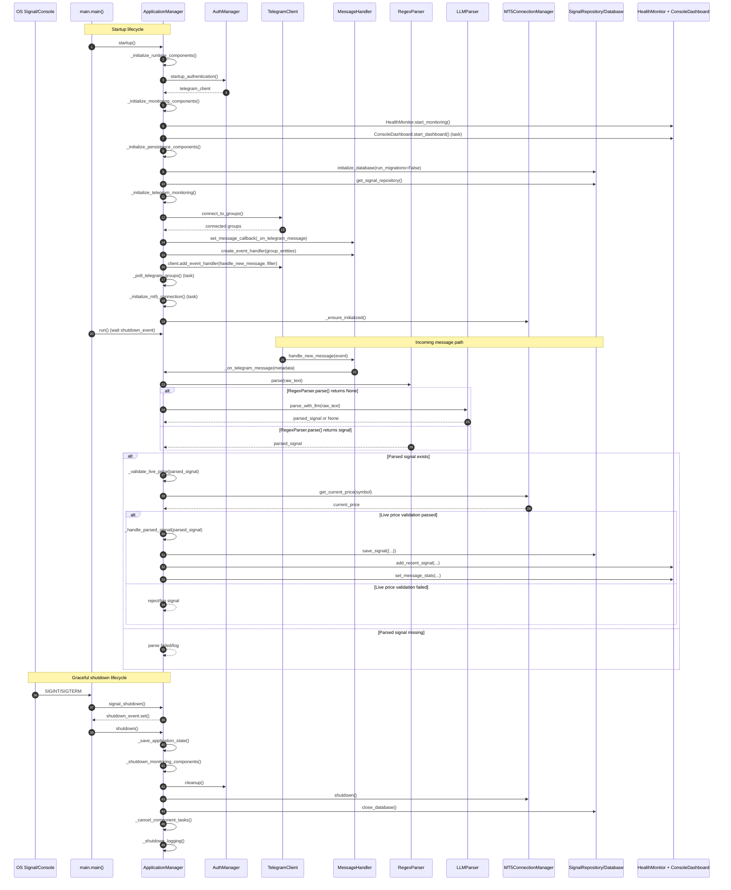

# Method-Level Execution Sequence

This diagram focuses on concrete method calls from the runtime entry point to shutdown so code navigation is easier.

## End-to-End Runtime Flow (Method Names)

## Primary Methods To Trace In Code

- `main.main`
- `ApplicationManager.startup`
- `ApplicationManager._initialize_runtime_components`
- `ApplicationManager._initialize_monitoring_components`
- `ApplicationManager._initialize_persistence_components`
- `ApplicationManager._initialize_telegram_monitoring`
- `ApplicationManager._on_telegram_message`
- `ApplicationManager._validate_live_price`
- `ApplicationManager._handle_parsed_signal`
- `ApplicationManager._poll_telegram_groups`
- `ApplicationManager._initialize_mt5_connection`
- `ApplicationManager.shutdown`